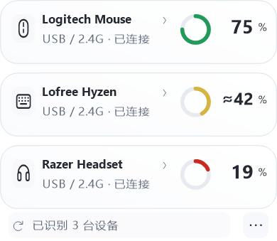

# MyFinder Device Battery

Windows 上的多品牌无线鼠标、耳机与键盘电量卡片，支持 MyDockFinder / MyFinder，也可独立作为系统托盘应用使用。

当前通用测试版 **1.3.0-beta.1**，适用于 Windows 10/11 x64。原生界面使用系统 .NET Framework，发行包内置设备读取组件，无需用户安装Python、厂商驱动或填写VID/PID。稳定版1.2.0仍可从历史Release获取。

自动识别范围见 [兼容清单](docs/compatibility.md)。目前包含26个通用读取器和原有专用适配：

- ATK HUB 识别为 **A9 Air+** 的2.4 GHz鼠标，已验证接收器 VID/PID `373B:1278`、FF02:0002、17字节报告。其他接收器或同名变体不保证兼容。
- **HyperX Cloud Alpha Wireless**，已验证 `03F0:098D`、FF43:0202、31字节报告。
- 音源切换和 Windows 麦克风静音支持用户主动绑定其他活动音频端点；这不会让其他耳机自动获得电量支持。
- 通用读取支持Logitech HID++鼠标/键盘/耳机、Razer无线鼠标和部分2.4G键盘，以及SteelSeries、HyperX、Corsair、ASUS ROG、Audeze、JBL、Pulsar、WLmouse、MCHOSE、Lofree等已列明型号。
- 蓝牙使用Windows已经提供的电量；标准HID设备只有明确声明电量字段时才读取。私有协议设备按内置型号表识别，不向未知接收器试发厂商命令。
- 自动按设备类型生成鼠标、耳机、键盘卡片；设备更多时可用滚轮或页码按钮浏览。通用设备只显示已有可靠能力，DPI写入继续只对已验证ATK开放。
- 支持设备插上接收器或完成系统蓝牙连接后即可读取。未支持或未返回数据的设备保持未知，不显示编造百分比；同品牌全系列与“市面所有设备”不作保证。




图片由实际绘制代码配合模拟状态生成，用于展示布局和操作反馈，不是实时硬件截图。

## 使用和安装

从 [Releases](https://github.com/wushuai0802/myfinder-device-battery/releases) 选择通用测试版Windows x64 ZIP并完整解压。保留`engine`目录与`outputs`目录；只复制exe会丢失通用读取能力。

1. 临时使用：运行 `启动.bat`，或 `outputs/AtkMouseBattery.exe --show`。
2. 稳定安装及自启：运行 `一键安装自启.bat`。程序复制到 `%LOCALAPPDATA%\Programs\MyFinderDeviceBattery`，再创建当前用户的启动文件夹和开始菜单快捷方式，无需管理员权限。
3. 以后更新会复用已记录的安装目录。稳定安装后可以移动或删除原解压包；直接运行的绿色模式需保留原目录。
4. 更新前先从托盘右键退出程序。安装器不会强行结束正在运行且需要替换的已安装程序；复制和注册失败会尝试回滚本次修改。

自定义安装目录：

```powershell
powershell.exe -NoProfile -ExecutionPolicy Bypass -File .\scripts\Install-Startup.ps1 -InstallDirectory D:\Tools\MyFinderDeviceBattery
```

运行 `一键卸载自启.bat` 只关闭自启，保留程序、开始菜单入口和设置。若要同时移除开始菜单入口：

```powershell
powershell.exe -NoProfile -ExecutionPolicy Bypass -File .\scripts\Uninstall-Startup.ps1 -RemoveStartMenu
```

安装器兼容 Windows PowerShell 5.1 和 PowerShell 7，并识别本程序旧版的乱码快捷方式。Windows“启动应用”中已禁用的项目需先手动启用。自启直接运行 GUI exe，没有 PowerShell窗口、计划任务、服务或 watchdog。

## 面板和操作

- 260px双行紧凑布局：鼠标和耳机分别为独立卡片，保留8px透明间距。四档时双设备约230px高，鼠标单卡约126px；五至八档使用两行。
- 左键点击托盘图标展开，点击其他窗口动画收起；`Esc`先返回上一级，再收起主面板。二级页返回时恢复原操作焦点。
- 开始菜单、`启动.bat` 或 `scripts/Start.ps1` 会唤出已运行实例的面板，保留单实例。启动脚本不是开机自启入口；开机仍安静运行。
- 鼠标卡片显示真实 DPI 档位；点击只选择现有档位，不改写档位数值。切换中显示目标，核验后再改变选中状态。刚确认的当前档位重复点击会跳过写入。
- 耳机卡片在无线连接确认后显示，使用独立卡片和8个逻辑像素的透明间距。音频接收器存在不代表耳机无线已连接。
- 点击立即反馈，设备或Windows核验后立即更新选中项；只有等待超过约280ms才显示待确认提示，不为动效增加延迟。连续点击合并到最后目标，失败保留已确认状态。
- 电量按设备上报能力显示。整数百分比使用1%显示单位；档位或电压估算明确显示“≈/约”，托盘以`~`标记，不假装精确到1%。鼠标、耳机、键盘和托盘共用绿/黄/红，未知或缓存为灰色。电量环保持角度稳定，不旋转充当加载动画。
- 音源和静音操作失败时显示短提示。输出切换保留通讯默认输出和默认录音设备。音源二级页提供当前系统输出的音量调节；拖动释放后应用，写入时核对端点并读回音量。
- `Tab` / `Shift+Tab` 或左右方向键移动焦点，`Enter` / 空格执行聚焦操作。
- 面板按所在显示器 DPI 缩放，绘图与命中坐标共用同一比例。四种比例有离线渲染与坐标检查；实际跨屏表现仍需具体设备验证。

如果 MyFinder 把图标放进溢出区，在 MyFinder 的逐应用托盘设置中允许显示本程序；本工具不改写 MyFinder 设置。

## 设置

点击公共底栏右侧的“更多”，或托盘右键的“设置…”；设置与详情都在同一浮层内打开：

- 分别选择扬声器、耳机、麦克风按钮绑定的 Windows 设备。
- 绑定默认自动识别 Realtek 扬声器和 HyperX 音频端点。自定义绑定按设备ID精确选择；设备断开后按钮不可用，不静默切换到其他设备。
- 在“音源与麦克风 → 更换按钮绑定”中选择精确端点。“自动识别”与当前绑定均可见；设备断开后保留原绑定。保存配置本身不切换音源或改变静音。
- 新安装默认自动选择有数据的设备，也可选鼠标优先、耳机优先、键盘优先或最低电量。已有明确来源偏好继续保留；新鲜数据优先，不轮流闪动数字。
- 低电量提醒默认关闭，可选择10%、15%或20%（默认20%）；每台设备每轮放电只提醒一次，充电或回升至30%后重新计数。缓存不触发提醒；全屏、演示或系统不允许通知时延后。
- 外观默认跟随系统，支持浅色/深色与减弱动效。偏好选项提供统一的选择页并自动保存；详情中的设备别名只影响本程序，不改系统或USB名称。
- “状态与诊断”显示自启与读取状态，可主动复制不含端点ID的诊断摘要。
- 接收器插拔、系统恢复会合并触发一次检查，仍保留原有定时兜底。耳机开机未必产生 Windows 设备事件。

托盘右键的“音源设置”还提供快速绑定、刷新设备列表和恢复默认音源识别。

## 刷新、缓存和安全

打开面板立即读取；面板内鼠标 DPI 每2秒调度，成功读取电量后至少30秒再读。耳机正常约6秒检查，失败后退避。面板关闭后默认每分钟检查，可选2分钟/5分钟；较慢间隔会延后耳机开机发现。没有新增常驻高频轮询。

通用读取进程随本程序启动和退出，通过本地管道通信，没有网络监听、服务、计划任务或额外watchdog。通用读取展开时最多每8秒触发；Windows蓝牙快照最多每分钟刷新一次、标准HID字段最多每30秒读取一次，打开面板和主动同步会立即请求。厂商GUI、配对、RGB、键位和固件操作不在读取组件内。

鼠标移动主要是唤醒硬件；真正读取由定时器、打开面板或手动刷新触发。未知值显示 `--`。读数失败保留上次成功数据并标明时间，超过新鲜度阈值会改变显示和提示；跨日缓存包含日期。电量和充电标记分别检查时效。

可跨重启保留最近7天的电量和原确认时间，启动时明确视为缓存，不保存充电状态，也不以历史数据判断耳机已开机。无线读取短暂失败时暂保留卡片与缓存，确认断开/接收器移除或超过保留期限后收起。

鼠标写入只选择已有 DPI 档位：核验设备身份、系统行、全部 DPI 行及校验值，写入后回读确认，失败时尝试恢复。鼠标操作串行处理，连续操作合并等待目标。耳机只使用已验证的查询命令，不写固件、配对或设备设置。

音源和麦克风操作独立排队，写入后核验并在失败时尝试恢复。麦克风按钮控制 Windows 端点静音，不能读取耳机物理静音开关。程序不联网，不读取账号、浏览器或密码管理器数据。

## 本地数据

目录：`%LOCALAPPDATA%\MyFinderDeviceBattery`。

| 文件 | 用途 |
| --- | --- |
| `audio-settings.json` | 音源绑定、主题、别名、托盘、提醒及同步偏好；自动兼容旧格式 |
| `readings-cache.json` | 电量与原确认时间，不包含设备ID；关闭保留读数后不使用、不更新 |
| `wireless-cache.json` | 通用设备电量与原确认时间，标识为散列值；不会用历史记录声明设备在线 |
| `install.json` | 稳定安装目录及快捷方式目标 |
| `status.json` | 运行诊断，不参与自动刷新控制 |
| `low-battery-state.txt` | 启用提醒后的去重记录 |
| `active-ui-render.png`、`visual-status.json` | 满足条件时生成的本机绘图诊断 |

运行状态文件不再由 Git 跟踪；卸载自启保留用户设置。更换驱动后 Windows 可能分配新的设备ID，需要重新绑定。

## 构建和验证

从源码仓库运行：

```powershell
powershell.exe -NoProfile -ExecutionPolicy Bypass -File .\scripts\Build.ps1 -OutputDirectory .\tmp\build
```

使用系统自带的 x64 .NET Framework 编译器，不下载依赖。构建会运行协议、设置、端点匹配、菜单、控制队列、缓存、低电量策略、DPI坐标和安装回滚检查。测试用模拟硬件和隔离文件夹，安装器检查分别覆盖 PowerShell 5.1、可用时的 PowerShell 7，不改真实自启项或音源。测试截图保存在指定输出目录下。

`scripts/Package.ps1 -OutputDirectory <目录>` 生成安装包及 `SHA256SUMS.txt`。GitHub Actions 在 main 推送及 PR 上构建并运行相同检查。离线检查不代替每种硬件、游戏和显示器组合的实测。

通用版打包会按`engine/dependencies.lock.json`固定URL与SHA256准备官方便携运行库。维护端可运行`Build-Backend.ps1`，再用`engine/runtime/python.exe -I -B tests/test_universal_engine.py`及`-m unittest discover -s engine/tests`检查协议与桥接。最终用户无需执行这些步骤。第三方许可见 [THIRD_PARTY_NOTICES.md](THIRD_PARTY_NOTICES.md)。

`AtkBatteryProbe.exe --help`、`--self-test` 不访问 HID。`--enumerate` 读描述符；`--power`、`--diagnostic` 查询设备；`--dpi-read` 读取 PAW3955 档位表；`--select-stage N` 会实际选择一个已有的一基档位。

## 参考

- [ATK 官方 HUB](https://bpcdn.atkgear.com/hub-v3/production/3.2.27/static/index-F-MYsmWR.js)
- [mouse_tray Windows Nordic 驱动参考](https://github.com/Fan4Metal/mouse_tray/blob/master/mouse_tray/drivers/chipset/nordic52.py)
- [mouse_tray 原生尺寸图标参考](https://github.com/Fan4Metal/mouse_tray/blob/master/mouse_tray/ui/icons.py)
- [MyDockFinder 托盘显示配置](https://github.com/mydockfinder/mydockfinder-for-Win10-Win11/blob/release/language/English.ini)
- [Apple 材质](https://developer.apple.com/design/human-interface-guidelines/materials)与[动效](https://developer.apple.com/design/human-interface-guidelines/motion)设计参考
