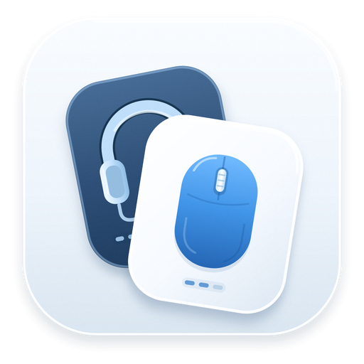
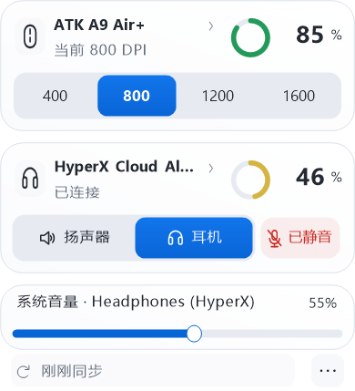
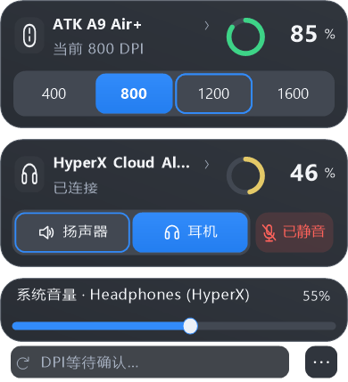

# MyFinder Device Battery



Windows 上的多品牌无线鼠标、耳机与键盘电量卡片，支持 MyDockFinder / MyFinder，也可独立作为系统托盘应用使用。

当前版本 **1.3.1**，适用于 Windows 10/11 x64。原生界面使用系统 .NET Framework，发行包内置设备读取组件，无需用户安装Python、厂商驱动或填写VID/PID。旧版本保留在历史Release中。

1.3.1 使用新的冰川蓝双卡应用图标，统一 EXE、开始菜单与启动快捷方式的显示；小尺寸采用简化轮廓。顶栏仍实时显示设备电量，独立于静态应用图标。

1.3.0 加入USB鼠标活动后的定向补读：读数过期或状态未确认时，移动对应鼠标会触发一次检查，读到新数据后及时更新卡片和顶栏。重复活动合并处理，保留后台定时同步。

正式版包含多品牌电量卡片、ATK与GPW独立DPI控制、系统音量、设备隐藏/排序及耳机音频绑定。PRO X Wireless（C547接收器）的快捷DPI只改变当前灵敏度，不改写板载档位、固件或配对；所有控制均核对目标并读回确认。此前测试版的读取隔离、安装回滚、托盘开关和视觉修复一并保留。

升级后，旧版仅按型号记录的通用设备缓存和别名不会自动套到新的物理设备标识；原配置保留，必要时可在设备详情重新命名。历史读数只有设备标识、类型和读取器都相符时才复用。

自动识别范围见 [兼容清单](docs/compatibility.md)。目前包含26个通用读取器和原有专用适配：

- ATK HUB 识别为 **A9 Air+** 的2.4 GHz鼠标，已验证接收器 VID/PID `373B:1278`、FF02:0002、17字节报告。其他接收器或同名变体不保证兼容。
- **HyperX Cloud Alpha Wireless**，已验证 `03F0:098D`、FF43:0202、31字节报告。
- 音源切换和 Windows 麦克风静音支持用户主动绑定其他活动音频端点；这不会让其他耳机自动获得电量支持。
- 通用读取支持Logitech HID++鼠标/键盘/耳机、Razer无线鼠标和部分2.4G键盘，以及SteelSeries、HyperX、Corsair、ASUS ROG、Audeze、JBL、Pulsar、WLmouse、MCHOSE、Lofree等已列明型号。
- 蓝牙使用Windows已经提供的电量；标准HID设备只有明确声明电量字段时才读取。私有协议设备按内置型号表识别，不向未知接收器试发厂商命令。
- 自动按设备类型生成鼠标、耳机、键盘卡片；设备更多时可用滚轮或页码按钮浏览。通用设备只显示已有可靠能力，DPI写入仅向已验证ATK及PRO X Wireless / C547开放。
- 支持设备插上接收器或完成系统蓝牙连接后即可读取。未支持或未返回数据的设备保持未知，不显示编造百分比；同品牌全系列与“市面所有设备”不作保证。





图片由实际绘制代码配合模拟状态生成，用于展示布局和操作反馈，不是实时硬件截图。

## 使用和安装

从 [Releases](https://github.com/wushuai0802/myfinder-device-battery/releases/latest) 下载正式版Windows x64 ZIP并完整解压。保留`engine`目录与`outputs`目录；只复制exe会丢失通用读取能力。

1. 临时使用：运行 `启动.bat`，或 `outputs/AtkMouseBattery.exe --show`。
2. 稳定安装及自启：运行 `一键安装自启.bat`。程序复制到 `%LOCALAPPDATA%\Programs\MyFinderDeviceBattery`，再创建当前用户的启动文件夹和开始菜单快捷方式，无需管理员权限。
3. 以后更新会复用已记录的安装目录。稳定安装后可以移动或删除原解压包；直接运行的绿色模式需保留原目录。
4. 更新前先从托盘右键退出程序，或运行新版 `outputs/AtkMouseBattery.exe --exit` 请求已支持该入口的版本退出；更早版本仍从托盘退出。安装器按整个发行包检查变化，即使exe未变、只有设备读取组件更新，也会先检查已安装主程序和便携读取进程是否退出。完整候选包先校验并暂存，再复制；复制和注册失败会恢复本次涉及的程序、读取组件、安装记录和快捷方式。用户设置不在安装事务中改写。

自定义安装目录：

```powershell
powershell.exe -NoProfile -ExecutionPolicy Bypass -File .\scripts\Install-Startup.ps1 -InstallDirectory D:\Tools\MyFinderDeviceBattery
```

运行 `一键卸载自启.bat` 只关闭自启，保留程序、开始菜单入口和设置。若要同时移除开始菜单入口：

```powershell
powershell.exe -NoProfile -ExecutionPolicy Bypass -File .\scripts\Uninstall-Startup.ps1 -RemoveStartMenu
```

移除程序使用 `-RemoveProgram`，同时清除个人设置再加 `-RemoveData`。两项都不会递归清空目录：程序清理只移除安装收据中哈希仍一致的自有文件，个人设置清理只移除本程序已知文件，未知或手动修改的文件会保留。完整卸载前请退出程序；默认不加参数仍只关闭自启。

```powershell
powershell.exe -NoProfile -ExecutionPolicy Bypass -File .\scripts\Uninstall-Startup.ps1 -RemoveProgram -RemoveData
```

完整包包含 `release.json`、`package-manifest.json` 与第三方许可证。安装前校验文件长度和SHA256，并记录版本、配置schema及自有文件清单；缺少运行库、文件被修改或路径不安全时拒绝安装。应用自启诊断区分可用、被Windows禁用、入口缺失、目标异常和无法确认，不自行修改Windows的启动禁用决定。

安装器兼容 Windows PowerShell 5.1 和 PowerShell 7，并识别本程序旧版的乱码快捷方式。Windows“启动应用”中已禁用的项目需先手动启用。自启直接运行 GUI exe，没有 PowerShell窗口、计划任务、服务或 watchdog。

## 面板和操作

- 260px双行紧凑布局：鼠标和耳机分别为独立卡片，保留8px透明间距。包含共用音量区后，四档时双设备约286px高，鼠标单卡约182px；五至八档使用两行，更多设备分页浏览。
- 左键逐次点击托盘图标展开或收起，点击其他窗口动画收起；`Esc`先返回上一级，再收起主面板。返回保留逻辑焦点，蓝色焦点描边只在键盘或无障碍操作时显示；鼠标导航及时收起旧提示气泡。
- 开始菜单、`启动.bat` 或 `scripts/Start.ps1` 会唤出已运行实例的面板，保留单实例。启动脚本不是开机自启入口；开机仍安静运行。
- ATK鼠标卡片显示真实 DPI 档位，点击选择现有档位。已适配GPW卡片显示“快捷DPI”，提供当前值和常用灵敏度；快捷值不代表设备保存的板载档位。切换中显示目标，同一设备暂时停用DPI按钮，核验后再改变选中状态。刚确认的当前值重复点击会跳过写入，断连或结果未知时先重新读取。
- 耳机卡片在无线连接确认后显示，使用独立卡片和8个逻辑像素的透明间距。音频接收器存在不代表耳机无线已连接。
- 点击立即反馈，设备或Windows核验后立即更新选中项；只有等待超过约280ms才显示待确认提示，不为动效增加延迟。连续点击合并到最后目标，失败保留已确认状态。
- 电量按设备上报能力显示。整数百分比使用1%显示单位；档位或电压估算明确显示“≈/约”，托盘以`~`标记，不假装精确到1%。鼠标、耳机、键盘和托盘共用绿/黄/红，未知或缓存为灰色。电量环保持角度稳定，不旋转充当加载动画。
- 主弹窗有一条共用的系统音量滑块，显示当前输出名称和百分比，支持拖动、键盘和无障碍调整。拖动释放后提交，保留合并与读回保护；外部音量或音源变化会同步，无默认输出或状态未确认时停用控制。设备详情仍可进入音频页做更完整的操作。
- 音源和静音操作失败时显示短提示。输出切换保留通讯默认输出和默认录音设备。操作提交时固定端点与绑定快照，改绑或切换设备页面会取消旧待办并核对新状态。
- `Tab` / `Shift+Tab` 或左右方向键移动焦点，`Enter` / 空格执行聚焦操作。
- 面板按所在显示器 DPI 缩放，绘图与命中坐标共用同一比例。100/125/150/175/200%五档比例有离线渲染与坐标检查；实际跨屏表现仍需具体设备验证。

如果 MyFinder 把图标放进溢出区，在 MyFinder 的逐应用托盘设置中允许显示本程序；本工具不改写 MyFinder 设置。

## 设置

点击公共底栏右侧的“更多”，或托盘右键的“设置…”；设置与详情都在同一浮层内打开：

- 分别选择扬声器、耳机、麦克风按钮绑定的 Windows 设备。
- 绑定默认自动识别 Realtek 扬声器和 HyperX 音频端点。自定义绑定按设备ID精确选择；设备断开后按钮不可用，不静默切换到其他设备。
- 在“音源与麦克风 → 更换按钮绑定”中选择精确端点。“自动识别”与当前绑定均可见；设备断开后保留原绑定。保存配置本身不切换音源或改变静音。
- 通用耳机的详情页可单独绑定 Windows 扬声器、耳机和麦克风端点；未绑定的角色显示不可用，不套用其他耳机的自动识别结果。离开该设备音频页后恢复全局控制，主弹窗音量始终面向当前系统输出。
- “设备管理”保留隐藏设备入口；在设备详情中可隐藏/恢复、置顶或上下移动。隐藏只影响本程序的显示和默认托盘候选，不禁用系统设备或停止读取。隐藏的固定设备暂时回退到其他可用设备，恢复显示后可继续使用原固定设置。
- 新安装默认自动选择有数据的设备，也可选鼠标优先、耳机优先、键盘优先或最低电量。在设备详情开启“固定为托盘主设备”可指定来源；卡片置顶只改变排列。固定设备暂时无有效读数时回退到其他可用设备，恢复后再选回。自动模式保持当前有效来源，不跟随最后移动的鼠标轮换数字。
- 低电量提醒默认关闭，可选择10%、15%或20%（默认20%）；每台设备每轮放电只提醒一次，充电或回升至30%后重新计数。缓存不触发提醒；全屏、演示或系统不允许通知时延后。
- 外观默认跟随系统，支持浅色/深色与减弱动效。偏好选项提供统一的选择页并自动保存；详情中的设备别名只影响本程序，不改系统或USB名称。
- “状态与诊断”显示自启与读取状态，可主动复制不含端点ID的诊断摘要。
- 接收器插拔、系统恢复会合并触发一次检查，仍保留原有定时兜底。耳机开机未必产生 Windows 设备事件。

托盘右键的“音源设置”还提供快速绑定、刷新设备列表和恢复默认音源识别。

## 刷新、缓存和安全

打开面板立即读取；面板内鼠标 DPI 每2秒调度，成功读取电量后至少30秒再读。耳机正常约6秒检查，失败后退避。面板关闭后默认每分钟检查，可选2分钟/5分钟；较慢间隔会延后耳机开机发现。没有新增常驻高频轮询。

电量的新鲜状态受90秒时效限制，还取决于读数来源和连接证据；这个窗口不会随后台间隔延长。选择120秒或300秒后台同步后，两次查询之间的电量可能先变灰并标为历史读数，保留原确认时间；这表示测量已过期，不据此判定设备断开。Windows蓝牙系统属性仍单独标明“系统提供”和最近查询时间，不冒充设备刚上报。

通用管理进程随本程序启动和退出，通过本地管道通信，最多使用两个按需读取槽，所有子树归本程序管理。没有网络监听、服务、计划任务或额外watchdog。通用读取展开时最多每8秒触发；Windows蓝牙快照默认至少间隔一分钟、标准HID字段至少30秒，打开面板和主动同步可立即请求。结果分批返回，同一物理接收器的查询串行，失败独立退避；慢调用到达预算后终止隔离进程，保留上次证据。厂商GUI、配对、RGB、键位和固件操作不在读取组件内。

面板关闭、完整轮询确认没有通用设备状态且读取器均正常无设备或不支持时，释放空闲读取槽；管理进程继续按原间隔工作。有设备、历史状态待确认或读取故障时保留对应上下文。展开面板时保留读取槽以减少反复启动。

USB/2.4G鼠标恢复活动时，如果该设备读数已过期或连接未确认，会按可靠的USB物理来源补读。活动通知按来源合并，初次唤醒尚未应答时仅进行有限补读；读数新鲜时不因持续移动重复查询。未知设备保留原有型号与描述符校验，无法可靠映射的来源继续使用定时同步。移动本身不更新电量时间、不冒充设备在线，取得真实读数后才恢复电量颜色。打开面板、手动刷新、设备事件和后台定时器也会触发检查。

未知值显示 `--`。读数失败保留上次成功数据并标明时间，超过新鲜度阈值会改变显示和提示；跨日缓存包含日期。电量和充电标记分别检查时效。

可跨重启保留最近7天的电量和原确认时间，启动时明确视为缓存，不保存充电状态，也不以历史数据判断耳机已开机。无线读取短暂失败时暂保留卡片与缓存，确认断开/接收器移除或超过保留期限后收起。

ATK写入只选择已有DPI档位，核验设备身份、系统行、档位及校验值，写入后回读确认。GPW使用独立的当前DPI命令，写前复核接收器、槽位、单元、支持范围与当前值，不改写板载预设；结果未知时不重试，重新确认前停用控制。鼠标补读与控制按所属队列串行处理。耳机只使用已验证的查询命令，不写固件、配对或设备设置。

音源和麦克风操作在隐藏受控进程中独立排队，写入后核验并在失败时尝试恢复。超时表示结果未确认，安全回收并读回之前暂停新的控制；绑定、操作目标和配置代次随请求固定，过期回读不覆盖新页面。成功读取到“无默认输出”的空状态会替换旧状态，避免继续操作已移除设备。端点、音量和静音变化优先接收Windows通知，保留轮询兜底。麦克风按钮控制Windows端点静音，不宣称已同步耳机物理静音开关。程序不联网，不读取账号、浏览器或密码管理器数据。

## 本地数据

目录：`%LOCALAPPDATA%\MyFinderDeviceBattery`。

| 文件 | 用途 |
| --- | --- |
| `audio-settings.json` | 音源绑定、主题、别名、托盘、提醒及同步偏好；自动兼容旧格式 |
| `readings-cache.json` | 电量与原确认时间，不包含设备ID；关闭保留读数后不使用、不更新 |
| `wireless-cache.json` | 通用设备电量与原确认时间，标识为散列值；不会用历史记录声明设备在线 |
| `install.json` | 稳定安装目录、版本、配置schema和自有文件哈希清单 |
| `status.json` | 运行诊断，不参与自动刷新控制 |
| `low-battery-state.txt` | 启用提醒后的去重记录 |
| `active-ui-render.png`、`visual-status.json` | 满足条件时生成的本机绘图诊断 |

运行状态文件不再由 Git 跟踪；卸载自启保留用户设置。更换驱动后 Windows 可能分配新的设备ID，需要重新绑定。

## 构建和验证

从源码仓库运行：

```powershell
powershell.exe -NoProfile -ExecutionPolicy Bypass -File .\scripts\Build.ps1 -OutputDirectory .\tmp\build
```

使用系统自带的 x64 .NET Framework 编译器，不下载依赖。构建会运行协议、设置、端点匹配、菜单、控制队列、缓存、低电量策略、DPI坐标和安装回滚检查。测试用模拟硬件和隔离文件夹，安装器检查分别覆盖 PowerShell 5.1、可用时的 PowerShell 7，不改真实自启项或音源。测试截图保存在指定输出目录下。

`release.json`是版本唯一来源；构建时生成程序集版本信息。`scripts/Package.ps1 -OutputDirectory <目录>` 生成完整ZIP、包内文件清单及 `SHA256SUMS.txt`。使用已经验证的构建可传 `-SkipBuild -BuildDirectory <构建目录>`；源码、版本或构建文件在验证后改变会拒绝打包。

GitHub Actions 在main推送及PR上构建、运行协议与安装回归，然后将同一份构建打包为最终ZIP，隔离解压安装后启动真实应用和便携读取器进行无硬件检查，验证正常退出与父进程异常退出的子进程回收，最后上传该ZIP和SHA256。安装器小型模拟exe测试不代替完整包检查。离线检查不代替每种硬件、游戏和显示器组合的实测。

验证边界、交互性能与八小时资源采样方法见 [验证范围与复验方法](docs/verification.md)。

通用版打包会按`engine/dependencies.lock.json`固定URL与SHA256准备官方便携运行库，复用已通过校验的下载缓存并校验官方Python签名。维护端可运行`Build-Backend.ps1`，再用`engine/runtime/python.exe -I -B -m unittest discover -s tests -p 'test_*.py'`及`-m unittest discover -s engine/tests`检查协议与桥接。最终用户无需执行这些步骤。自有代码采用[MIT许可证](LICENSE)，第三方许可见 [THIRD_PARTY_NOTICES.md](THIRD_PARTY_NOTICES.md)。

`AtkBatteryProbe.exe --help`、`--self-test` 不访问 HID。`--enumerate` 读描述符；`--power`、`--diagnostic` 查询设备；`--dpi-read` 读取 PAW3955 档位表；`--select-stage N` 会实际选择一个已有的一基档位。

## 参考

- [ATK 官方 HUB](https://bpcdn.atkgear.com/hub-v3/production/3.2.27/static/index-F-MYsmWR.js)
- [mouse_tray Windows Nordic 驱动参考](https://github.com/Fan4Metal/mouse_tray/blob/master/mouse_tray/drivers/chipset/nordic52.py)
- [mouse_tray 原生尺寸图标参考](https://github.com/Fan4Metal/mouse_tray/blob/master/mouse_tray/ui/icons.py)
- [MyDockFinder 托盘显示配置](https://github.com/mydockfinder/mydockfinder-for-Win10-Win11/blob/release/language/English.ini)
- [Apple 材质](https://developer.apple.com/design/human-interface-guidelines/materials)与[动效](https://developer.apple.com/design/human-interface-guidelines/motion)设计参考
