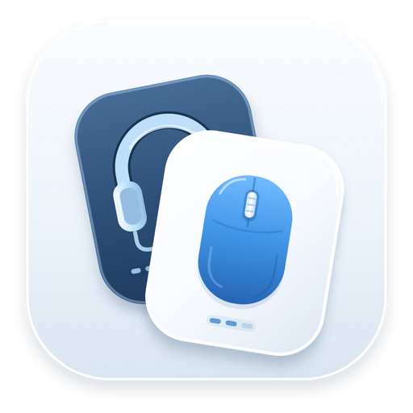
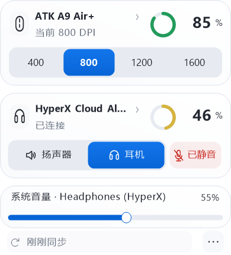
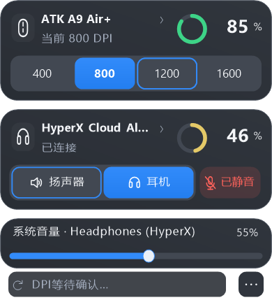

# MyFinder Device Battery



Windows 上的多品牌无线鼠标、耳机与键盘电量卡片，支持 MyDockFinder / MyFinder，也可独立作为系统托盘应用使用。

当前源码版本 **1.3.5-beta.9**（测试版），适用于 Windows 10/11 x64。原生界面使用系统 .NET Framework，发行包内置设备读取组件，无需用户安装Python、厂商驱动或填写VID/PID。公开可下载版本以 Releases 页面为准，旧版本保留在历史Release中。

1.3.5-beta.9 修复 beta.8 弹窗在真实桌面上的黑角、残影和叠字；更新后自动打开的面板贴在托盘图标旁；更新窗口缩小，不再默认全选说明；悬停高亮改为淡底色。

1.3.5-beta.8 更新、反馈、改名和提示窗口改用主面板的卡片、按钮和配色；修复从 PowerShell 7 等环境启动时一键更新失败、且失败后程序没有重新启动的问题。

1.3.5-beta.7 修复无线耳机关机后，接收器的音频端点被误当成有线耳机、显示“耳机”卡片的问题。

1.3.5-beta.6 新增程序内反馈（不需要 GitHub 账号）和托盘分组：最多 4 个托盘图标，可选设备图标样式；修正诊断里的 Windows 版本。分组和多图标尚未实机验证。

1.3.5-beta.5 精简菜单，新增“设备没显示？”页和四套配色（海蓝、原生、琥珀、青雾），合并托盘显示规则，加大电量数字并突出低电量。界面改动只用假数据渲染检查过，尚未实机验证。

1.3.5-beta.4 修复发行包无法一键更新的问题；1.3.5-beta.2、beta.3 的包只能手动安装，但已装的 beta.2、beta.3 可以一键更新到本版本。完整更新流程尚待用户实测。

1.3.5-beta.3 修复100%电量显示为省略号和切到耳机后回不了扬声器的问题，收起的音量栏改为只有点三角才展开。

1.3.5-beta.2 隐藏同一设备的重复连接，增加一键反馈、托盘跟随当前使用的鼠标、可收起音量栏、有线耳机快捷音频，开放G Pro Wireless的DPI切换，并加入带签名校验的自动更新。2026-11-03 收到单个用户反馈：重复卡片已消失，G Pro Wireless 有线和无线都能切换DPI，托盘跟随和耳机卡片正常。

1.3.5-beta.1 试验按协议族读取未列明的ATK设备，诊断摘要可列出未取得电量的设备，并改用AGPL-3.0-only许可。2026-11-02 收到单个用户反馈：ATK A9 Air 电量正确；仅为该用户的只读电量证据，等级仍为 C，不代表整个协议族已验证，也不开放 DPI。

1.3.4 修复轮询预算不足造成的失败误报，并缓存稳定路径集合下的完整HID描述符；路径变化或定向刷新时重读动态产品字符串。这两项尚未用真实Audeze或慢速读取器实测。

1.3.3 优化蓝牙查询频率与轮询顺序：连续成功查询仍无带电量设备时降低查询频率，优先完成HID读取；面板打开时蓝牙结果可在下次轮询显示，面板关闭时同步等待。

1.3.2 加固原生 ATK 的接收器身份与旧请求隔离，修复快照写入竞态，增加可见的诊断写入健康与实例标识。同步时间按真实读数显示，不增加常驻轮询，也不扩大设备协议范围。

1.3.1 使用新的冰川蓝双卡应用图标，统一 EXE、开始菜单与启动快捷方式的显示；小尺寸采用简化轮廓。顶栏仍实时显示设备电量，独立于静态应用图标。

1.3.0 加入USB鼠标活动后的定向补读：读数过期或状态未确认时，移动对应鼠标会触发一次检查，读到新数据后及时更新卡片和顶栏。重复活动合并处理，保留后台定时同步。

正式版包含多品牌电量卡片、ATK与GPW独立DPI控制、系统音量、设备隐藏/排序及耳机音频绑定。PRO X Wireless（C547接收器）的快捷DPI只改变当前灵敏度，不改写板载档位、固件或配对；所有控制均核对目标并读回确认。此前测试版的读取隔离、安装回滚、托盘开关和视觉修复一并保留。

升级后，旧版仅按型号记录的通用设备缓存和别名不会自动套到新的物理设备标识；原配置保留，必要时可在设备详情重新命名。历史读数只有设备标识、类型和读取器都相符时才复用。

自动识别范围见 [兼容清单](docs/compatibility.md)。目前包含26个通用读取器和原有专用适配：

- ATK HUB 识别为 **A9 Air+** 的2.4 GHz鼠标，已验证接收器 VID/PID `373B:1278`、FF02:0002、17字节报告。其他接收器或同名变体不保证兼容。
- **HyperX Cloud Alpha Wireless**，已验证 `03F0:098D`、FF43:0202、31字节报告。
- 音源切换和 Windows 麦克风静音支持用户主动绑定其他活动音频端点；这不会让其他耳机自动获得电量支持。
- 通用读取支持Logitech HID++鼠标/键盘/耳机、Razer无线鼠标和部分2.4G键盘，以及SteelSeries、HyperX、Corsair、ASUS ROG、Audeze、JBL、Pulsar、WLmouse、MCHOSE、Lofree等已列明型号。
- 蓝牙使用Windows已经提供的电量；标准HID设备只有明确声明电量字段时才读取。私有协议设备按内置型号表识别，不向未知接收器试发厂商命令。
- 自动按设备类型生成鼠标、耳机、键盘卡片；设备更多时可用滚轮或页码按钮浏览。通用设备只显示已有可靠能力，DPI写入限原生ATK、PRO X Wireless / C547及下述精确名称的G Pro Wireless Gaming Mouse。
- 支持设备插上接收器或完成系统蓝牙连接后即可读取。未支持或未返回数据的设备保持未知，不显示编造百分比；同品牌全系列与“市面所有设备”不作保证。





图片由实际绘制代码配合模拟状态生成，用于展示布局和操作反馈，不是实时硬件截图。

## 使用和安装

从 [Releases](https://github.com/wushuai0802/myfinder-device-battery/releases/latest) 下载正式版Windows x64 ZIP并完整解压。保留`engine`目录与`outputs`目录；只复制exe会丢失通用读取能力。

1. 临时使用：运行 `启动.bat`，或 `outputs/AtkMouseBattery.exe --show`。
2. 稳定安装及自启：运行 `一键安装自启.bat`。程序复制到 `%LOCALAPPDATA%\Programs\MyFinderDeviceBattery`，再创建当前用户的启动文件夹和开始菜单快捷方式，无需管理员权限。
3. 以后更新会复用已记录的安装目录。稳定安装后可以移动或删除原解压包；直接运行的绿色模式需保留原目录。
4. 更新前先从托盘右键退出程序，或运行新版 `outputs/AtkMouseBattery.exe --exit` 请求已支持该入口的版本退出；更早版本仍从托盘退出。安装器按整个发行包检查变化，即使exe未变、只有设备读取组件更新，也会先检查已安装主程序和便携读取进程是否退出。完整候选包先校验并暂存，再复制；复制和注册失败会恢复本次涉及的程序、读取组件、安装记录和快捷方式。用户设置不在安装事务中改写。

自定义安装目录：

```powershell
powershell.exe -NoProfile -ExecutionPolicy Bypass -File .\scripts\Install-Startup.ps1 -InstallDirectory D:\Tools\MyFinderDeviceBattery
```

运行 `一键卸载自启.bat` 只关闭自启，保留程序、开始菜单入口和设置。若要同时移除开始菜单入口：

```powershell
powershell.exe -NoProfile -ExecutionPolicy Bypass -File .\scripts\Uninstall-Startup.ps1 -RemoveStartMenu
```

移除程序使用 `-RemoveProgram`，同时清除个人设置再加 `-RemoveData`。两项都不会递归清空目录：程序清理只移除安装收据中哈希仍一致的自有文件，个人设置清理只移除本程序已知文件，未知或手动修改的文件会保留。完整卸载前请退出程序；默认不加参数仍只关闭自启。

```powershell
powershell.exe -NoProfile -ExecutionPolicy Bypass -File .\scripts\Uninstall-Startup.ps1 -RemoveProgram -RemoveData
```

完整包包含 `release.json`、`package-manifest.json` 与第三方许可证。安装前校验文件长度和SHA256，并记录版本、配置schema及自有文件清单；缺少运行库、文件被修改或路径不安全时拒绝安装。应用自启诊断区分可用、被Windows禁用、入口缺失、目标异常和无法确认，不自行修改Windows的启动禁用决定。

安装器兼容 Windows PowerShell 5.1 和 PowerShell 7，并识别本程序旧版的乱码快捷方式。Windows“启动应用”中已禁用的项目需先手动启用。自启直接运行 GUI exe，没有 PowerShell窗口、计划任务、服务或 watchdog。

## 面板和操作

- “显示与提醒 → 托盘图标”可添加分组，最多同时显示 4 个电量图标。第 1 组包含未分到其他组的设备；其他组可命名、选择成员，并按当前使用的鼠标、最低电量或固定设备显示。每台设备只属于一个组，删除分组后成员回到第 1 组；空组保留灰色图标。Windows 可能把新图标收进隐藏区，可在“设置 → 个性化 → 任务栏 → 其他系统托盘图标”中打开。
- 所有托盘图标可统一选择“数字”或“设备图标”样式。设备图标用鼠标、键盘、耳机或通用设备图形配底部电量条，保留电量等级色、充电标记及历史读数的灰色提示；每个图标都打开同一个面板和右键菜单。
- 260px双行紧凑布局：鼠标和耳机分别为独立卡片，保留8px透明间距。包含共用音量区后，四档时双设备约286px高，鼠标单卡约182px；五至八档使用两行，更多设备分页浏览。
- 左键逐次点击托盘图标展开或收起，点击其他窗口动画收起；`Esc`先返回上一级，再收起主面板。返回保留逻辑焦点，蓝色焦点描边只在键盘或无障碍操作时显示；鼠标导航及时收起旧提示气泡。
- 开始菜单、`启动.bat` 或 `scripts/Start.ps1` 会唤出已运行实例的面板，保留单实例。启动脚本不是开机自启入口；开机仍安静运行。
- ATK鼠标卡片显示真实 DPI 档位，点击选择现有档位。已适配GPW卡片显示“快捷DPI”，提供当前值和常用灵敏度；快捷值不代表设备保存的板载档位。切换中显示待确认目标，核验后再改变选中状态；ATK连续选择串行保留最后意图。刚确认的当前值重复点击会跳过写入，断连、读数过期或结果未知时停用控制并先重新读取。
- 原生耳机电量卡片在无线连接确认后显示，音频接收器存在不代表无线已连接。没有原生卡片时，活动的已绑定耳机输出，或Windows报告的耳机类输出端点，可显示一张“耳机”快捷音频卡片，提供扬声器、耳机和麦克风按钮；这张卡片不显示电量，不声明无线连接，副标题显示端点名称。多个候选且未绑定时停用耳机按钮并提示绑定。通用无线耳机同样可用这张音频卡片；原生卡片显示时不会重复，设备管理可隐藏它。
- 点击立即反馈，设备或Windows核验后立即更新选中项；只有等待超过约280ms才显示待确认提示，不为动效增加延迟。连续点击合并到最后目标，失败保留已确认状态。
- 电量按设备上报能力显示。整数百分比使用1%显示单位；档位或电压估算明确显示“≈/约”，托盘以`~`标记，不假装精确到1%。鼠标、耳机、键盘和托盘共用绿/黄/红，未知或缓存为灰色。电量环保持角度稳定，不旋转充当加载动画。
- 主弹窗有一条共用的系统音量滑块，显示当前输出名称和百分比，支持拖动、键盘和无障碍调整。右上角可立即收起为图标与百分比窄条，点击窄条或聚焦后按空格/回车展开；收起后没有滑块命中区域，状态保存到`VolumeCollapsed`，重启保留，默认展开。拖动释放后提交；收起会取消未释放的拖动预览，已提交的音量队列仍照常核验。外部音量或音源变化会同步，无默认输出或状态未确认时停用音量调整。设备详情仍可进入音频页做更完整的操作。
- 音源和静音操作失败时显示短提示。输出切换保留通讯默认输出和默认录音设备。操作提交时固定端点与绑定快照，改绑或切换设备页面会取消旧待办并核对新状态。
- `Tab` / `Shift+Tab` 或左右方向键移动焦点，`Enter` / 空格执行聚焦操作。
- 面板按所在显示器 DPI 缩放，绘图与命中坐标共用同一比例。100/125/150/175/200%五档比例有离线渲染与坐标检查；实际跨屏表现仍需具体设备验证。

如果 MyFinder 把图标放进溢出区，在 MyFinder 的逐应用托盘设置中允许显示本程序；本工具不改写 MyFinder 设置。

## 设置

点击公共底栏右侧的“更多”，或托盘右键的“设置…”；设置与详情都在同一浮层内打开：

- 分别选择扬声器、耳机、麦克风按钮绑定的 Windows 设备。
- 绑定默认保留 Realtek 扬声器和 HyperX 音频端点识别；没有匹配的HyperX输出时，可识别唯一的Windows耳机类活动输出（`Headphones=3`、`Headset=5`，见[Windows枚举](https://learn.microsoft.com/en-us/windows/win32/api/mmdeviceapi/ne-mmdeviceapi-endpointformfactor)）。自定义绑定按设备ID精确选择；设备断开后按钮不可用，不静默切换到其他设备。
- 快捷音频卡片按Windows现有音频事件更新插拔，不新增轮询；候选只来自`DEVICE_STATE_ACTIVE`端点。3.5mm插孔取决于驱动，可能拔出后仍报告活动，或将耳机报告成扬声器；可在现有音频设置中绑定端点，但无法补足驱动未报告的插拔状态。识别、插拔和保存绑定本身不会切换默认设备，只有点击输出按钮才切换。
- 在“音源与麦克风 → 更换按钮绑定”中选择精确端点。“自动识别”与当前绑定均可见；设备断开后保留原绑定。保存配置本身不切换音源或改变静音。
- 通用耳机的详情页可单独绑定 Windows 扬声器、耳机和麦克风端点；未绑定的角色显示不可用，不套用其他耳机的自动识别结果。离开该设备音频页后恢复全局控制，主弹窗音量始终面向当前系统输出。
- “设备管理”保留隐藏设备入口；在设备详情中可隐藏/恢复、置顶或上下移动。隐藏只影响本程序的显示和默认托盘候选，不禁用系统设备或停止读取。隐藏的固定设备暂时回退到其他可用设备，恢复显示后可继续使用原固定设置。
- 无配置文件的新安装默认“当前使用的设备”（`active`），仅依据现有USB鼠标活动，按物理连接匹配电量卡片；不判断键盘、音频或蓝牙活动。切换后至少3秒才接受另一只鼠标，锁屏时不跟随；无活动、设备消失或没有电量时使用原有自动选择规则。已有配置保留原值，旧文件缺省项仍按原来的鼠标优先处理。可改选自动、鼠标优先、耳机优先、键盘优先或最低电量；自动模式保持当前有效来源。设备详情中“固定为托盘主设备”优先级最高，固定设备暂时无有效读数时按原规则回退，恢复后再选回；卡片置顶只改变排列。
- 降级前请将托盘来源改为“自动”并保存：旧版本会拒绝含`active`的配置，暂时使用整份默认设置（包括音频绑定等），而非仅回退托盘选项。原文件保留，旧版再次保存时现有机制先尝试备份为`audio-settings.json.unread.bak`。
- 低电量提醒默认关闭，可选择10%、15%或20%（默认20%）；每台设备每轮放电只提醒一次，充电或回升至30%后重新计数。缓存不触发提醒；全屏、演示或系统不允许通知时延后。
- 外观默认跟随系统，支持浅色/深色与减弱动效。偏好选项提供统一的选择页并自动保存；详情中的设备别名只影响本程序，不改系统或USB名称。
- 同一设备的有线/接收器旧连接满足严格条件时暂时隐藏；两张都是当前读数、同一接收器不同槽位均保留。诊断摘要可查看“已隐藏的重复连接”，恢复读数后重新显示。两只同名鼠标电量接近且其中一只休眠时也可能暂时隐藏，详见[兼容边界](docs/compatibility.md)。
- “状态与诊断”显示自启与读取状态，可主动复制本机诊断摘要。“状态与诊断”和“设备没显示？”中的“反馈问题”打开反馈窗口，可选择类型、填写描述、选择是否附带诊断，并查看完整诊断。反馈使用独立报告，仅包含程序/Windows 版本、卡片设备原始名称、类型、读取器、电量与当前读数标志、明确匹配的 VID:PID、隐藏连接、未取得电量设备及异常读取器状态；不含别名、音频端点、进程/实例身份、路径、序列号或 physicalId。隐藏连接和未取得电量设备列表不写入 `status.json`。请不要在描述中填写个人信息。
- 反馈可在程序内提交，不需要 GitHub 账号。中转服务不可用时，可点击“改用浏览器提交”，复制类型、描述和所选诊断，并用默认浏览器打开预填的 issue 表单，需要 GitHub 账号。提交前可检查内容，预填失败时可粘贴剪贴板报告；URL 上限 6000 字符，超长先去掉健康项，再从末尾去掉未取得电量设备，仍超长才裁减隐藏连接和卡片列表，必要时截断链接中的描述，并注明“已截断；完整内容已复制”。剪贴板保留完整描述和所选诊断。
- 接收器插拔、系统恢复会合并触发一次检查，仍保留原有定时兜底。耳机开机未必产生 Windows 设备事件。

托盘右键的“音源设置”还提供快速绑定、刷新设备列表和恢复默认音源识别。

## 刷新、缓存和安全

打开面板立即读取；面板内鼠标 DPI 每2秒调度，成功读取电量后至少30秒再读。耳机正常约6秒检查，失败后退避。面板关闭后默认每分钟检查，可选2分钟/5分钟；较慢间隔会延后耳机开机发现。没有新增常驻高频轮询。

电量的新鲜状态受90秒时效限制，还取决于读数来源和连接证据；这个窗口不会随后台间隔延长。选择120秒或300秒后台同步后，两次查询之间的电量可能先变灰并标为历史读数，保留原确认时间；这表示测量已过期，不据此判定设备断开。Windows蓝牙系统属性仍单独标明“系统提供”和最近查询时间，不冒充设备刚上报。

通用管理进程随本程序启动和退出，通过本地管道通信，最多使用两个按需读取槽，所有子树归本程序管理。没有网络监听、服务、计划任务或额外watchdog。通用读取展开时最多每8秒触发；Windows蓝牙快照默认至少间隔一分钟，连续三次成功查询均无带电量的设备后改为至少五分钟，查到带电量的设备或HID接口路径集合变化后恢复一分钟；标准HID字段至少30秒，打开面板和主动同步可立即请求。较慢间隔下，新连接的蓝牙设备可能要等到打开面板或下一次查询才出现。结果分批返回；面板打开时，蓝牙结果可能在下一次轮询才出现；面板关闭时在本轮预算允许时同步等待蓝牙结果。预算不足的查询延后并在下一轮优先，不记作读取失败。同一物理接收器的查询串行，失败独立退避；慢调用到达预算后终止隔离进程，保留上次证据。厂商GUI、配对、RGB、键位和固件操作不在读取组件内。

面板关闭、完整轮询确认没有通用设备状态且读取器均正常无设备或不支持时，释放空闲读取槽；管理进程继续按原间隔工作。有设备、历史状态待确认或读取故障时保留对应上下文。展开面板时保留读取槽以减少反复启动。

USB/2.4G鼠标恢复活动时，如果该设备读数已过期或连接未确认，会按可靠的USB物理来源补读。活动通知按来源合并，初次唤醒尚未应答时仅进行有限补读；读数新鲜时不因持续移动重复查询。未知设备保留原有型号与描述符校验，无法可靠映射的来源继续使用定时同步。移动本身不更新电量时间、不冒充设备在线，取得真实读数后才恢复电量颜色。打开面板、手动刷新、设备事件和后台定时器也会触发检查。

未知值显示 `--`。读数失败保留上次成功数据并标明时间，超过新鲜度阈值会改变显示和提示；跨日缓存包含日期。电量和充电标记分别检查时效。

可跨重启保留最近7天的电量和原确认时间，启动时明确视为缓存，不保存充电状态，也不以历史数据判断耳机已开机。无线读取短暂失败时暂保留卡片与缓存，确认断开/接收器移除或超过保留期限后收起。

ATK界面请求固定到用户点击时的接收器、目标DPI值和连接代次；写前复核接收器、型号、档位表和校验值，写后读回确认。接收器或档位表变化时取消旧请求，旧回读不能更新新实例；多个同型号原生接收器仍拒绝歧义。GPW使用独立的当前DPI命令，写前复核接收器、槽位、单元、支持范围与当前值，不改写板载预设；结果未知时不重试，重新确认前停用控制。鼠标补读与控制按所属队列串行处理。耳机只使用已验证的查询命令，不写固件、配对或设备设置。

精确设备名`G Pro Wireless Gaming Mouse`的DPI控制**已开放，待用户实测**：接收器仅限`C539/C53A/C53D/C53F/C541/C545/C547/C54D`；插线使用槽位`0xFF`，必须有现有HID++长集合写入路径和可靠的非零单元ID，缺失时不开放。`PRO X Wireless / C547`原有行为保留，其他型号或近似名称不开放。两种连接均只发送`0x2201`易失写入，先复核身份和当前值，只接受设备报告的支持值，写后读回，不重试、不写板载配置；尚无本次用户设备的接收器PID、插线身份及实际操作结果。

音源和麦克风操作在隐藏受控进程中独立排队，写入后核验并在失败时尝试恢复。超时表示结果未确认，安全回收并读回之前暂停新的控制；绑定、操作目标和配置代次随请求固定，过期回读不覆盖新页面。成功读取到“无默认输出”的空状态会替换旧状态，避免继续操作已移除设备。端点、音量和静音变化优先接收Windows通知，保留轮询兜底。麦克风按钮控制Windows端点静音，不宣称已同步耳机物理静音开关。不读取账号、浏览器或密码管理器数据；联网仅用于下述更新检查和用户确认后的更新下载。

## 软件更新

“显示与提醒”中的 `AutoCheckUpdates`（自动检查更新）默认开启，可关闭；关闭后不自动发出更新请求，托盘右键或“状态与诊断”的“检查更新”仍可手动使用。自动检查在启动至少两分钟后进行，之后每24小时最多一次；失败只记录诊断，不弹窗、不立即重试，HTTP 403/429 会遵守至少24小时及服务端更长的 Retry-After。

程序以 HTTPS / TLS 1.2 请求本仓库的 GitHub Releases API，只附加普通的 `User-Agent: MyFinderDeviceBattery/<版本>`，不上传设备信息、诊断、设置、账号或设备/实例标识符。GitHub 仍会像普通网络请求一样看到来源 IP。正式版只检查正式发布，测试版同时检查正式版和 `-beta.N`，忽略草稿和无法解析的版本；只接受高于当前版本的更新。

只有用户在反馈窗口点击提交时，程序才会把所填类型、描述和（可选的）诊断发送到反馈中转服务 `https://myfinder-feedback-relay.wushuai0802.deno.net`（[服务源码](https://github.com/wushuai0802/myfinder-feedback-relay)）。中转服务不保存反馈内容，反馈会发布为公开的 GitHub issue；服务不可用时可改用上述浏览器提交流程。程序不内置 GitHub token，更新检查也不会上传反馈内容。

发现新版本后，托盘最多提醒一次，“更多选项”和“状态与诊断”显示“有新版本”。可在版本对话框中“跳过此版本”，之后不再提示它；更高版本恢复提示。发布说明按有长度上限的纯文本显示，不执行脚本、不解析或自动打开说明中的链接。

只有点击“更新并重启”才会下载安装。稳定安装须同时满足：现有安装器 `Read-DeviceBatteryReceipt` 读取的数据目录 `install.json` 指向当前程序目录，并通过 `.myfinder-device-battery-install.json` 目录归属检查。绿色解压模式只提供发布页面和稳定安装说明，不下载覆盖原解压目录。

更新依次校验内置 RSA 公钥对 `SHA256SUMS.txt` **原始字节**的 RSA-SHA256 / PKCS#1 v1.5 签名、其中精确文件名对应的 ZIP SHA256，再拒绝 ZIP 路径穿越、绝对路径、盘符、备用数据流及链接，核对 `release.json` 的应用身份/版本和 `package-manifest.json` 的文件长度/SHA256。缺失签名、任何不符或降级都会中止；HTTPS 和 SHA256 不能代替签名。下载仅接受本仓库发布信息中的三个精确附件，HTTPS 重定向主机限定 `github.com`、`objects.githubusercontent.com`、`release-assets.githubusercontent.com`，不接受其他主机或 HTTP；单文件上限100 MB，有连接/读取和总耗时限制。

下载暂存于 `%LOCALAPPDATA%\MyFinderDeviceBattery\updates\<版本>\`，开始前检查暂存盘、安装盘及安装器临时盘空间，同盘需求合并计算。隐藏的系统 PowerShell 辅助进程等待现有 `--exit` 正常退出流程结束（最多60秒），不会强杀读取进程；随后再次独立验签并解压，调用校验包内的 `scripts\Install-Startup.ps1` / `Install-DeviceBattery` 完成原有暂存、校验和事务回滚。成功后重启新版本，失败后核对并启动已回滚的旧版本，下次启动显示失败原因。用户设置保留，不要求管理员权限。成功、失败、取消后清理本次暂存；异常断电留下的暂存超过一天后在下次启动清理。

已发布的 **1.3.4 及之前版本、1.3.5-beta.1 没有更新功能**，须先手动安装一次后续带更新功能的版本。若签名私钥丢失，不能通过本更新通道换公钥，用户只能手动下载新版本完成公钥更换。

## 本地数据

目录：`%LOCALAPPDATA%\MyFinderDeviceBattery`。

| 文件 | 用途 |
| --- | --- |
| `audio-settings.json` | 音源绑定、主题、别名、托盘、提醒及同步偏好；自动兼容旧格式 |
| `readings-cache.json` | 电量与原确认时间，不包含设备ID；关闭保留读数后不使用、不更新 |
| `wireless-cache.json` | 通用设备电量与原确认时间，标识为散列值；不会用历史记录声明设备在线 |
| `install.json` | 稳定安装目录、版本、配置schema和自有文件哈希清单 |
| `update-state.json` | 上次检查时间、限流期限、跳过和已提示的版本 |
| `update-result.json`、`update.log` | 更新结果及失败原因，供下次启动提示；不上传 |
| `updates\<版本>\` | 按次隔离的更新下载、校验与辅助脚本暂存 |
| `status.json` | 运行诊断，包含进程/实例身份、独立生成时间与写盘健康；不参与自动刷新控制 |
| `low-battery-state.txt` | 启用提醒后的去重记录 |
| `active-ui-render.png`、`visual-status.json` | 满足条件时生成的本机绘图诊断 |

运行状态文件不再由 Git 跟踪；卸载自启保留用户设置。更换驱动后 Windows 可能分配新的设备ID，需要重新绑定。

状态与诊断页显示诊断写入健康。文件中 `snapshotGeneratedAtUtc` 是本次快照生成时间，`persistence.lastSuccessfulStatusWriteUtc` 是生成该快照前最近一次已完成的状态文件写入，不是本次写入的完成回执。读取文件时还应核对 PID、启动时间、文件修改时间；旧文件不能证明当前设备在线。写入失败最多即时重试两次，后续正常状态更新可再次尝试，不创建后台守护。

## 构建和验证

源码仓库不包含预编译程序，请从 [Releases](https://github.com/wushuai0802/myfinder-device-battery/releases) 下载完整发行包；从源码运行需在源码根目录依次完成两步：先不带参数运行 `scripts\Build.ps1`（默认输出到 `outputs\`），再运行 `scripts\Build-Backend.ps1 -OutputDirectory .\engine\runtime` 准备通用设备读取组件。

从源码仓库运行：

```powershell
powershell.exe -NoProfile -ExecutionPolicy Bypass -File .\scripts\Build.ps1 -OutputDirectory .\tmp\build
```

使用系统自带的 x64 .NET Framework 编译器，不下载依赖。构建会运行协议、设置、端点匹配、菜单、控制队列、缓存、低电量策略、DPI坐标和安装回滚检查。测试用模拟硬件和隔离文件夹，安装器检查分别覆盖 PowerShell 5.1、可用时的 PowerShell 7，不改真实自启项或音源。测试截图保存在指定输出目录下。

`release.json`是版本唯一来源；构建时生成程序集版本信息。`scripts/Package.ps1 -OutputDirectory <目录>` 生成完整ZIP、包内文件清单及 `SHA256SUMS.txt`。使用已经验证的构建可传 `-SkipBuild -BuildDirectory <构建目录>`；源码、版本或构建文件在验证后改变会拒绝打包。

发布维护步骤：等待准确提交的 CI 全部通过，下载该次 CI 的完整发行 ZIP 和 `SHA256SUMS.txt`，核对 ZIP 哈希后，在本机对校验和文件签名：

```powershell
.\scripts\Sign-Release.ps1 -ReleaseDirectory <CI产物目录> -PrivateKeyPath <仓库外的私钥XML路径>
```

签名工具只从参数指定路径读取私钥，在内存中签名并立即用程序内置公钥复验；验证成功才写出二进制 `SHA256SUMS.txt.sig`。私钥不得进入仓库、CI、发布附件或日志。将原样的 ZIP、`SHA256SUMS.txt` 和 `SHA256SUMS.txt.sig` 三个附件一起上传发布；签名后不能改动校验和文件的换行或任何字节。

更新回归使用临时生成的测试密钥和假 HTTP 层；可注入公钥的下载测试入口仅以 `UPDATE_TESTS` 编译，生产下载只使用内置常量。独立校验入口为 `AtkMouseBattery.exe --verify-update-package <zip> <sums> <sig> <新版本> <全新解压目录>`（生产公钥，不启动界面/读取器）。CI 的 `PackageSmoke` 另用只校验目录的 `--validate-update-directory <目录> <版本>` 检查尚未签名的包，不需要私钥，该入口不安装、不等于已通过发布验签。

GitHub Actions 在main推送及PR上构建、运行协议与安装回归，然后将同一份构建打包为最终ZIP，隔离解压安装后启动真实应用和便携读取器进行无硬件检查，验证正常退出与父进程异常退出的子进程回收，最后上传该ZIP和SHA256。安装器小型模拟exe测试不代替完整包检查。离线检查不代替每种硬件、游戏和显示器组合的实测。

验证边界、交互性能与八小时资源采样方法见 [验证范围与复验方法](docs/verification.md)。

通用版打包会按`engine/dependencies.lock.json`固定URL与SHA256准备官方便携运行库，复用已通过校验的下载缓存并校验官方Python签名。维护端可运行`Build-Backend.ps1`，再用`engine/runtime/python.exe -I -B -m unittest discover -s tests -p 'test_*.py'`及`-m unittest discover -s engine/tests`检查协议与桥接。最终用户无需执行这些步骤。

自有代码采用 [AGPL-3.0-only](LICENSE)，按现状提供，不提供任何担保。1.3.4 及更早版本按 MIT 发布，下一版本起为 AGPL-3.0-only。改编自 HaloBattery 的部分保留其 MIT 声明，第三方许可见 [THIRD_PARTY_NOTICES.md](THIRD_PARTY_NOTICES.md)；源码地址为 https://github.com/wushuai0802/myfinder-device-battery 。许可证、无担保说明与源码地址也可在“状态与诊断”页查看。

`AtkBatteryProbe.exe --help`、`--self-test` 不访问 HID。`--enumerate` 读描述符；`--power`、`--diagnostic` 查询设备；`--dpi-read` 读取 PAW3955 档位表；`--select-stage N` 会实际选择一个已有的一基档位。

## 参考

- [ATK 官方 HUB](https://bpcdn.atkgear.com/hub-v3/production/3.2.27/static/index-F-MYsmWR.js)
- [mouse_tray Windows Nordic 驱动参考](https://github.com/Fan4Metal/mouse_tray/blob/master/mouse_tray/drivers/chipset/nordic52.py)
- [mouse_tray 原生尺寸图标参考](https://github.com/Fan4Metal/mouse_tray/blob/master/mouse_tray/ui/icons.py)
- [MyDockFinder 托盘显示配置](https://github.com/mydockfinder/mydockfinder-for-Win10-Win11/blob/release/language/English.ini)
- [Apple 材质](https://developer.apple.com/design/human-interface-guidelines/materials)与[动效](https://developer.apple.com/design/human-interface-guidelines/motion)设计参考
